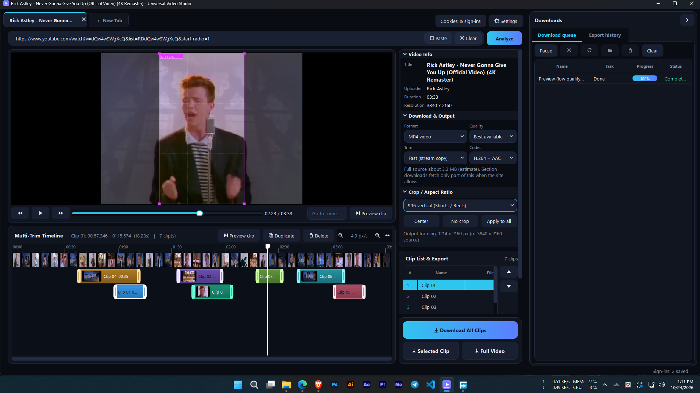
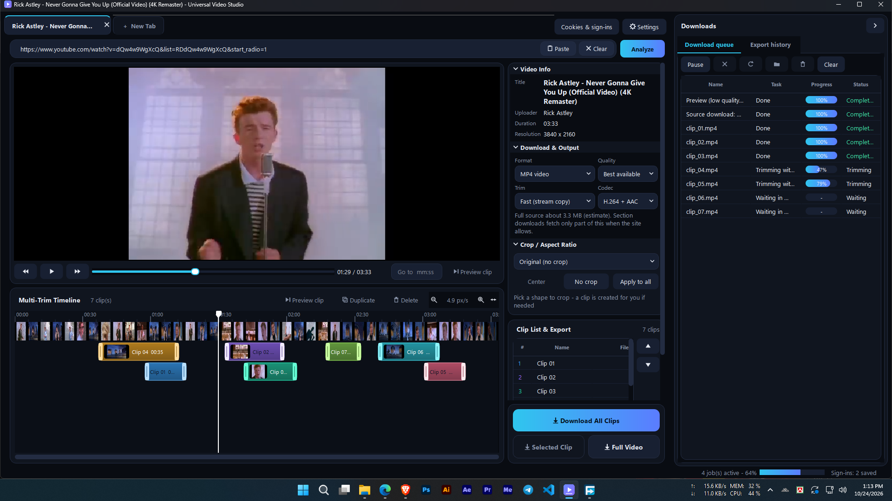
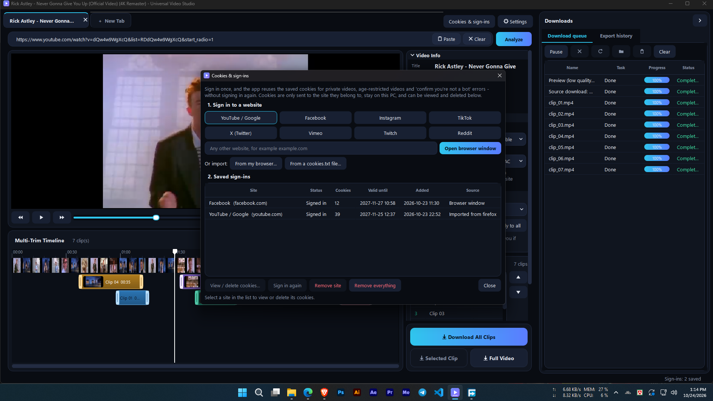
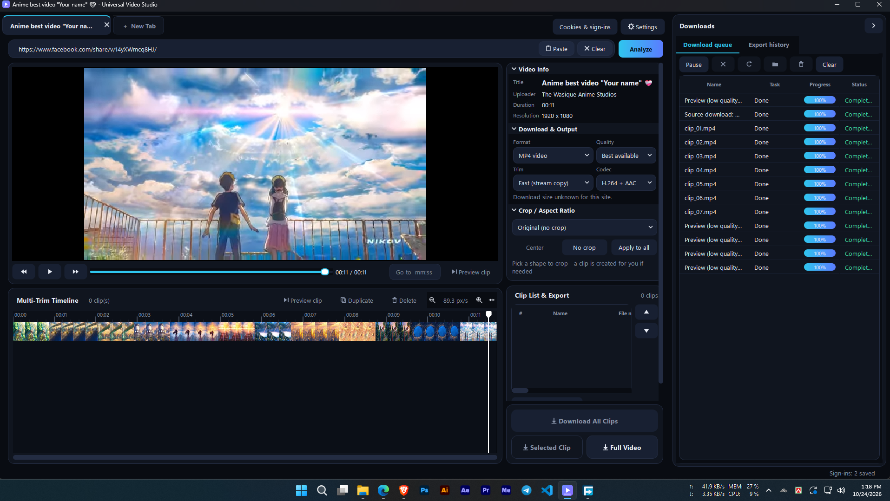
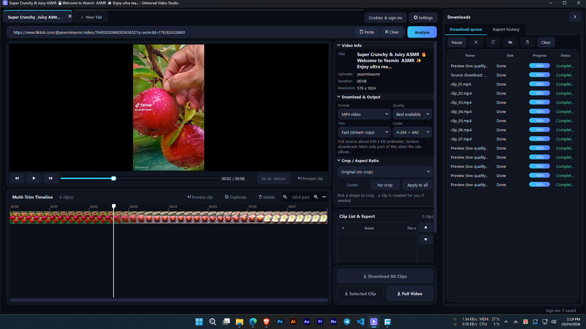
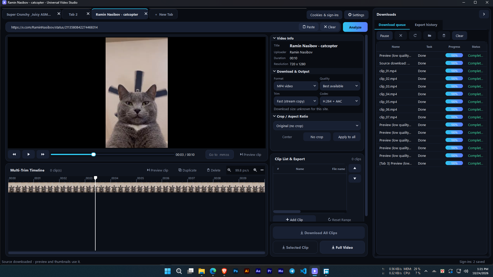

# Universal Video Studio

A free, open-source Windows application for downloading videos, extracting audio, and creating clips from online videos.

Universal Video Studio brings video downloading and basic clip editing into one desktop application, with support for playlists, download queues, video previews, flexible cropping, and GPU-accelerated encoding.

## Features

### Video Downloading
- Download videos from supported websites using yt-dlp.
- Download individual videos or playlists where supported.
- Choose from available video and audio quality options.
- Extract audio and save it as MP3 where supported.
- Manage multiple downloads through a queue.
- View download progress and history.
- Use browser cookies or supported sign-in methods for content you are authorized to access.

### Video Preview and Clip Editing
- Preview videos before selecting clips.
- Work with multiple clip sections on a timeline.
- Set the start and end points of individual clips.
- Download or export selected clips as separate MP4 files.
- Keep multiple clip selections organized in one workflow.
- Adjust crop settings independently for each clip.
- Apply crop settings to all clips when desired.

### Flexible Cropping
- Preset aspect ratios: 16:9, 9:16, 1:1, and Original.
- Custom aspect ratio support.
- Free rectangle cropping for flexible framing.
- Adjust crop position and size to select the desired area.
- Configure different crop settings for individual clips.

**Note:** Cropping requires video re-encoding. Depending on the source video, selected settings, and hardware, this may take longer than downloading or trimming without re-encoding.

### Performance
- GPU-accelerated encoding where supported by the available hardware and FFmpeg build.
- CPU-based processing when GPU encoding is unavailable or not selected.
- Download and processing workflows designed for desktop use.

Actual performance depends on your hardware, source video, output settings, and installed components.

### Windows Desktop Experience
- Native desktop interface.
- Organized tabs and controls for different workflows.
- Download queue and history management.
- Settings for supported application options.
- A workflow designed to keep downloading and clip creation together.

## Screenshots













## Requirements

- Windows 10 or Windows 11, 64-bit recommended.
- Internet connection for online downloads.
- Required application dependencies, such as FFmpeg and Deno, depending on the workflow and build.
- A supported GPU and compatible FFmpeg build for GPU-accelerated encoding.

Some websites, formats, or download methods may require additional configuration.

## Installation

### Option 1: Download a Release

1. Open the project's GitHub Releases page.
2. Download the latest Windows release, if one is available.
3. Extract the downloaded archive if necessary.
4. Follow the included setup instructions.
5. Install or download any required dependencies when prompted by the application.

GitHub Releases: https://github.com/yuppost/universal-video-downloader/releases

If no release is available yet, use the source-code installation instructions below.

### Option 2: Run from Source

1. Install a compatible version of Python.
2. Install Git if you want to clone the repository.
3. Clone the repository:

   ```bash
   git clone https://github.com/yuppost/universal-video-downloader.git
   ```

4. Open the project directory:

   ```bash
   cd universal-video-downloader
   ```

5. Create and activate a virtual environment:

   ```bash
   python -m venv .venv
   ```

   On Windows Command Prompt:

   ```bat
   .venv\Scripts\activate
   ```

   On PowerShell:

   ```powershell
   .\.venv\Scripts\Activate.ps1
   ```

6. Install the project's Python dependencies using its dependency file, if provided. For example:

   ```bash
   pip install -r requirements.txt
   ```

7. Install and configure the required external tools according to the project's instructions.
8. Run the application's documented entry-point script.

**Important:** The exact Python version, dependency file, entry-point script, and external-tool setup depend on the current source code. Follow the instructions included in the repository if they differ from these general steps.

## External Dependencies

Universal Video Studio relies on external tools for some downloading and video-processing operations.

### yt-dlp

yt-dlp handles downloading from supported websites. Website changes may occasionally affect compatibility, and updating yt-dlp may be necessary.

Official project: https://github.com/yt-dlp/yt-dlp

### FFmpeg

FFmpeg is used for video and audio processing, including trimming, cropping, conversion, and encoding.

Official website: https://ffmpeg.org/

The available encoding features depend on the installed FFmpeg build and the hardware it supports.

### Deno

Some supported download workflows may use Deno. Install or configure it if the application requests it.

Official website: https://deno.com/

Follow the application's instructions for installing and detecting required external tools. Do not download executables from untrusted sources.

## Usage

### Download a Video

1. Open Universal Video Studio.
2. Enter a URL supported by yt-dlp.
3. Select the available format or quality options.
4. Choose the destination or other supported download settings.
5. Start the download and monitor its progress.

Available options vary by website and source video.

### Download a Playlist

1. Enter a supported playlist URL.
2. Review the detected playlist items and available options.
3. Select the items you want to download, if selection is supported.
4. Start the download and monitor the queue.

Playlist availability and selection behavior depend on the source and application configuration.

### Extract Audio

1. Enter a supported video URL.
2. Select the MP3 or audio extraction option, if available.
3. Choose the destination and start processing.

Audio quality depends on the source audio and the selected conversion settings. Converting an existing compressed audio stream does not restore lost quality.

### Create Multiple Clips

1. Open the supported video preview or clip-editing workflow.
2. Load or select the source video.
3. Mark the start and end points for each desired clip.
4. Add additional clip sections as needed.
5. Review the selected sections.
6. Choose the output options and download or export the clips as separate MP4 files.

The exact controls may vary between application versions.

### Crop a Video

1. Open the crop controls for the clip you want to edit.
2. Select a preset ratio, such as 16:9, 9:16, 1:1, or Original.
3. Alternatively, enter a custom aspect ratio or select a free rectangle.
4. Adjust the crop position and size.
5. Review the framing in the preview, where available.
6. Configure other clips independently, or use Apply to All if you want to reuse the same crop settings.
7. Export the clip.

Cropping requires re-encoding and may increase processing time.

## GPU Acceleration

Universal Video Studio can use GPU-accelerated encoding when the selected encoder, FFmpeg build, drivers, and hardware support it.

GPU acceleration is not guaranteed for every operation. Downloading, decoding, encoding, and cropping may use different processing paths.

If GPU encoding fails:

1. Confirm that your graphics drivers are installed and up to date.
2. Check whether your FFmpeg build supports the selected hardware encoder.
3. Try a supported encoder or CPU encoding.
4. Review the application's error output or logs, if available.

## Privacy and Security

- Only enter URLs and credentials into workflows you trust.
- Browser cookies and sign-in information can grant access to personal accounts. Treat exported cookie files and authentication data as sensitive.
- Do not share cookie files, session tokens, passwords, or other authentication data.
- Downloaded media is saved according to the application's configured destination and options.
- Review the source code and dependencies if you want to understand how the application handles data.

Do not assume that every workflow is completely offline or that all data remains local. Online downloading requires network access, and website authentication behavior depends on the selected method.

## Responsible Use

Universal Video Studio is a general-purpose downloading and video-processing tool.

You are responsible for ensuring that your use of the application complies with applicable laws, copyright requirements, website terms of service, and the rights of content owners.

Only download, process, or redistribute media when you have the necessary rights or authorization. Do not use the application to bypass access controls or to obtain content unlawfully.

## Troubleshooting

### A Download Fails

- Check that the URL is valid and supported.
- Confirm that the source video is still available.
- Check your internet connection.
- Update yt-dlp if the application supports updating it.
- Check whether the website requires authorized authentication.

### FFmpeg Is Missing

Install or configure a compatible FFmpeg build and make sure the application can locate it. Follow the application's dependency instructions.

### Deno Is Missing

If a workflow requires Deno, install it from the official website and ensure the application can detect it.

### A Website Is Not Supported

yt-dlp compatibility varies by website and may change when websites update their systems. Not every URL, private video, livestream, or protected source is supported.

### Cropping Is Slow

Cropping requires re-encoding. Try a shorter clip, a lower output resolution, or a supported hardware encoder.

### GPU Encoding Fails

Check your drivers and FFmpeg encoder support. If the selected hardware encoder is unavailable, try another supported encoder or CPU encoding.

### The Application Does Not Start

- Check the included installation instructions.
- Confirm that the required dependencies are installed.
- Review any error messages or application logs.
- If the issue persists, open a GitHub issue with the relevant error details.

Do not include passwords, cookies, session tokens, or other private information in bug reports.

## Known Limitations

- Website compatibility depends on yt-dlp and changes made by individual websites.
- Some sources require authentication or may not be accessible.
- Available download formats and quality options vary by source.
- GPU encoding depends on hardware, drivers, and the installed FFmpeg build.
- Cropping requires re-encoding.
- Exact behavior and available options may vary by application version.

## Contributing

Contributions, bug reports, and suggestions are welcome.

Before submitting a contribution:

1. Check existing issues to avoid duplicates.
2. Describe the problem or proposed improvement clearly.
3. Include reproducible steps for bugs where possible.
4. Avoid sharing credentials, cookies, or private account information.
5. Ensure your contribution respects the project's license and the licenses of third-party components.

To report an issue, visit:

https://github.com/yuppost/universal-video-downloader/issues

## Development and Testing

If you are contributing code:

- Use a compatible Python environment.
- Follow the existing project structure and coding conventions.
- Install the project's documented development dependencies.
- Run the available tests and relevant manual checks before submitting changes.

Test commands and development requirements should be documented alongside the project's source code.

## License

Universal Video Studio is licensed under the Apache License, Version 2.0. See the [LICENSE](LICENSE) file for the complete license text.

You may use, reproduce, modify, distribute, sublicense, and sell copies of the project under the terms of the Apache License 2.0. Redistribution must comply with the license requirements, including retaining applicable copyright, patent, trademark, and attribution notices and providing a copy of the license.

This license applies to the original project code covered by the project's copyright. Third-party tools, libraries, and bundled components remain subject to their respective licenses and terms.

## Third-Party Licenses

Universal Video Studio may use or interact with third-party software, including:

- **Python** — Python Software Foundation License.
- **yt-dlp** — Unlicense, subject to applicable notices and third-party component licenses.
- **FFmpeg** — Licensing depends on the specific build and enabled components; LGPL or GPL terms may apply.
- **Deno** — MIT License.
- **Other dependencies** — Subject to their respective licenses.

Check the official project documentation and license files for the versions and builds you use. When distributing a packaged application, include required notices and comply with all applicable license conditions.

Official resources:

- Python: https://www.python.org/
- yt-dlp: https://github.com/yt-dlp/yt-dlp
- FFmpeg legal information: https://ffmpeg.org/legal.html
- Deno: https://deno.com/

## Disclaimer

This software is provided "as is", without warranty of any kind, express or implied. See the Apache License 2.0 in the [LICENSE](LICENSE) file for the full warranty disclaimer and limitation of liability.

Universal Video Studio is not affiliated with, endorsed by, or officially connected to the websites supported by yt-dlp unless explicitly stated.

---

**Repository:** https://github.com/yuppost/universal-video-downloader

**Issues and feature requests:** https://github.com/yuppost/universal-video-downloader/issues
